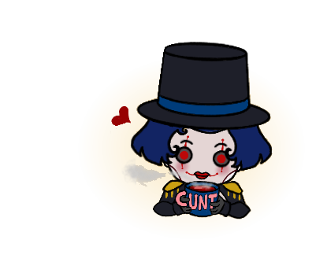
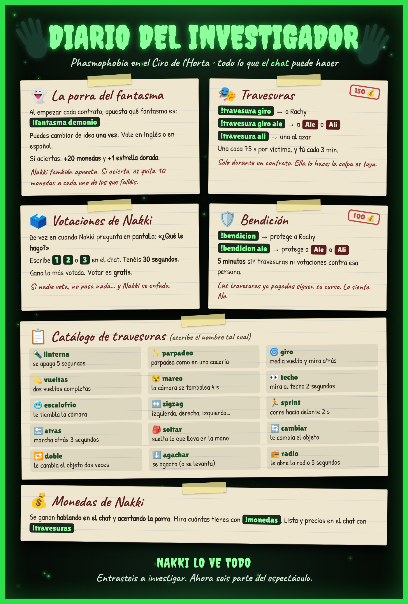
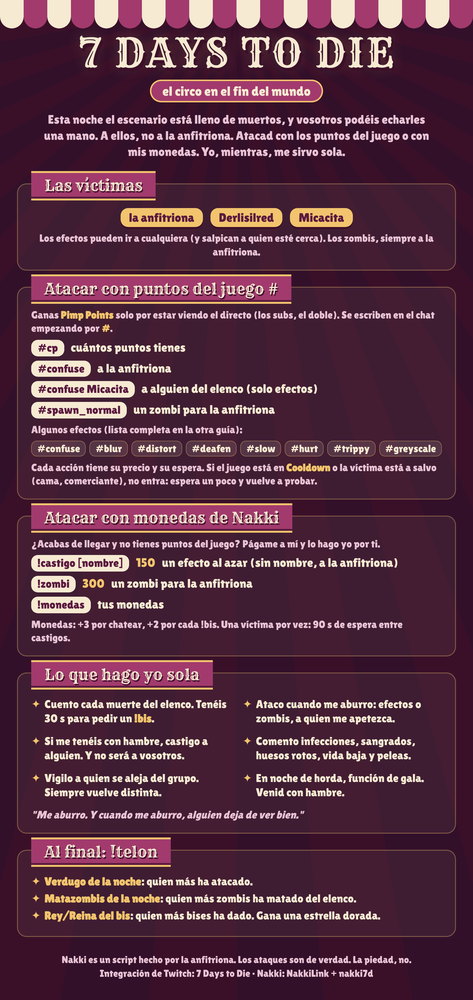

# Nakki
(Repositorio que contiene la expliación y comandos para usar a Nakki desde el chat (Twitch:cirdelhorta))

## Contenido
1. [¿Quién es Nakki?](##-1.-¿Quién-es-Nakki?)
2. [Juega con Nakki](##-2.-Juega-con-Nakki)
3. [Nakki en Phasmophobia](##-3.-Nakki-en-Phasmophobia)
4. [Nakki en 7 Days to Die](##-4.-Nakki-en-7-Days-to-Die)
5. [Nakki en otros juegos](##-5.-Nakki-en-otros-juegos)
6. [Nakki en The Sims 4](##-6.-Nakki-en-The-Sims-4)

## 1. ¿Quién es Nakki?
Nakki es la maestra de ceremonias del canal.

Encontró mi canal abandonado, en desuso, entró... y la puerta se cerró tras de ella. Ahora el circo es suyo.

Se alimento de vosotros (vuestra atención y emociones, sobre todo las negativas) y de los nervios, la rabia y el miedo de la anfitriona (aka yo). Si la descuidamos, se enfada, y cuando se enfada el circo toma la pantalla 🎭 (como pantalla tintada, gifs, sonidos... todo para impedir que vea bien lo que hago en el juego)

## 2. Juega con Nakki
Nakki cuenta con comandos básicos compartidos entre juegos. Adivina el fantasma es una modalidad usada en el Phasmophobia, y se explica más adelante mejor.
Lo más importante es conseguir monedas Nakki, y para ello debéis escribir en el chat. Cada vez que escribáis equivale a +3 monedas (máx. 1 vez cada 5 s, sin spam).

.png)

## 3. Nakki en Phasmophobia
Cuando juego al Phasmophobia, Nakki tendrá una modalidad específica y podrá aplicar comandos nuevos.
Cada vez que entramos en una casa nueva, abro sesión con "!contrato" y Nakki ofrece votaciones para que cada uno pueda apostar qué fantasma es. Si un viewer acierta, se lleva +20 monedas y +1 estrella dorada. Nakki también apuesta al azar al iniciar la porra. Si todos fallamos y Nakki acierta, nos quita 10 monedas a cada uno.

¡También puede fastidiarme a mis colegas y a mí (travesuras)! Hay comandos específicos para que podáis ayudarla (o protegernos). Los precios pueden ir variando según funcionen mejor o peor, pero iré actualizándolo aquí.

## 4. Nakki en 7 Days to Die
Al igual que con el Phasmophobia, también hay comandos específicos para el 7D2D. Además, solemos jugar con el Twitch integrated que ofrece el juego, el cual está integrado también en Nakki.

Esta es la información general de cómo Nakki funciona en el contexto del 7D2D.

Estos son los comandos que pueden usarse con el Twitch integrated. También los podéis encontrar online, pero los dejo aquí para que esté todo en el mismo sitio.

Jugamos ahora mismo con el mod REBIRTH, y luego tres mods que he creado yo (quizás algún día los publique): mod que permite a los zombis ahogarse si entran en el agua (esto lo hice porque queríamos poder tener una base en medio de un lago jaja); mod que genera un porcentaje de subbioma "deep forest" dentro del bioma bosque que tiene más densidad de árboles y niebla densa, además el hierro sólo se encuentra ahí; y finalmente un mod que introduce sanidad, descontando sanidad a más permanecemos en la oscuridad, obligándonos a encontrar un balance entre ir a escondidas y evitar los efectos de baja sanidad (tipo borracho).

## 5. Nakki en otros juegose
En el resto de juegos (Remnant 2, Lords of the Fallen, RunEscape Dragonwilds, etc), Nakki aún cuenta las muertas (y sustos cuando aplique), y los comandos básicos aplican (tintar pantalla, gif, sonido...). De momento sólo puede afectarme a mí, pero próximamente iré añadiendo para que también se le pueda hacer a mis compañeras.

## 6. Nakki en The Sims 4
Estoy trabajando en un mod en el que Nakki puede controlar un Sim (tanto en solitario como un Sim que vive con el mío), mientras oímos sus pensamientos y por qué decide hacer ciertas acciones. Todo on-premises, usando los recursos de mi portátil en exclusiva. Pero aún está en desarrollo (soy nueva a moddear los Sims).

## Si tenéis alguna sugerencia, podéis mandarla al Twitter del canal (@CircDeLHorta).
(Arte de Nakki hecho por mí, no usar. Nakki está inspirada en el personaje Nikola Orsinov de The Magnus Archives, un podcast del que soy muy fan -de hecho jugamos al roleplay de TMA en el canal también-. Nakki es un script hecho por Rachy. No muerde. Casi. · Disclaimer: Nakki es un programa offline que lee el chat en tiempo real. Nakki’s voice (AlesiaDavina, Pixabay))
